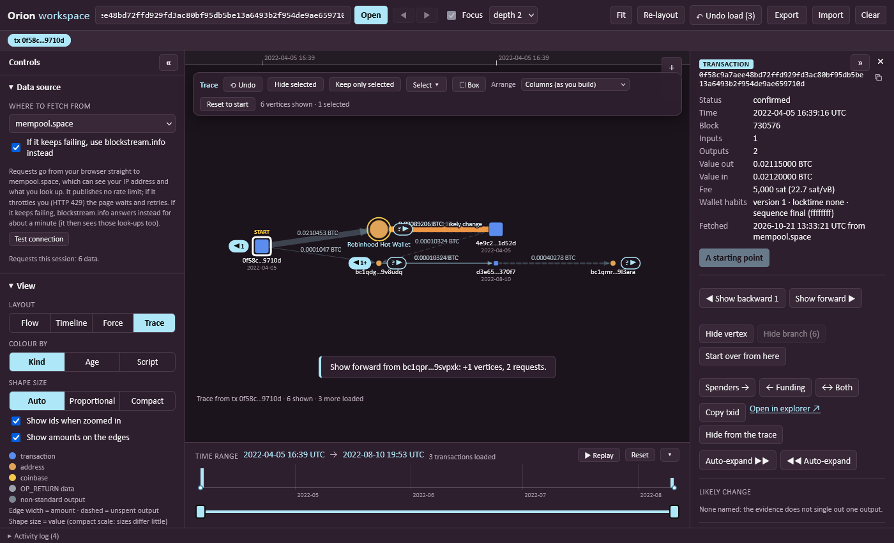

# Hopline

Bitcoin investigation tools that run in your browser: nothing to install and no server of their own. They ask a public block explorer API (mempool.space, with Blockstream.info as its backup, or your own server) and keep your work on your machine.

**Where to start:** open `index.html`, paste an address or a transaction ID, and it opens the right page. A transaction ID opens in the workspace, an address as a wallet overview.

* **Workspace** (`public/workspace.html`) - a graph of transactions and wallets: trace the money step by step, group and filter, find patterns, label wallets, and write a report you can hand over.
* **Wallet overview** (`public/wallet.html?q=<address>`) - one address as a ledger.

**Running it:** open `index.html` straight from the folder, or serve the folder with `python tools/serve.py` and open <http://127.0.0.1:8000/index.html>. Prefer that to `python -m http.server`: the standard server lets the browser keep copies of the scripts, so after an update a page can come up blank, or part of it can run old code, until you press Ctrl+F5. `tools/serve.py` tells the browser to keep nothing (it listens on this computer only and never writes anything). If a page says it could not start, that is the cause: reload with Ctrl+F5.

**Status:** in development, not published yet. Licensed under the Apache License 2.0 (see the end). What is planned: [ROADMAP.md](ROADMAP.md).

## Wallet overview

One address as a ledger, in the style of a wallet explorer: a summary (balance, total received, total sent, pending, number of transactions, first and last seen), an *Associations* list of the labelled wallets that appear in the loaded transactions, and then every transaction as a card with its **inputs on the left (red amounts) and its outputs on the right (green amounts)**. The wallet's own lines are marked, each card says when it happened (UTC), in which block, the fee, what it did to the wallet (*received*, *sent*, *moved within*; change that came back is netted off) and the **balance after it**, worked backwards from today's confirmed balance so it is right even when only the newest part of the history is loaded. Every other address links to its own overview, a transaction opens in the workspace (or in the explorer), a QR code appears when you hover (or focus) the address, and the loaded transactions can be filtered *All / In / Out* and downloaded as CSV (inputs and outputs as `address=sats`; cells that could run as spreadsheet formulas are defused).

History is loaded 25 transactions at a time (*Load 25 more*). Names come from the built-in list and from the label lists you saved in the workspace (they are read from this browser's storage; a switched-off list adds nothing); a name is somebody's claim, not proof, and everything that comes from outside is shown as text only. The page follows the data source you chose in the workspace, including the backup server, and says which server answered. Open it from `index.html`, from the *Wallet overview ↗* link in a wallet's details in the workspace, or directly: `public/wallet.html?q=<address>`.

## Workspace

The workspace (`public/workspace.html`) is an investigation workspace that keeps, for every vertex, when each transaction confirmed, how much moved, and what kind of script each address uses.

* **Trace** (under *Layout*) - **the layout the workspace starts in**, for working from a single piece of evidence, such as a threat actor's wallet, and following the money. Open a wallet or a transaction and it shows **only the one wallet or transaction** you started from (marked START). Click **▶** beside a vertex to show where the money went, **◀** for where it came from; each click moves one wallet along the chain and the vertices already on screen **stay where they are**, so the picture grows without being rearranged. A wallet click shows the transactions that spent from it and the wallets they paid; a transaction click shows its wallets. The handle says how much is waiting: **3** is three known vertices, **3+** means more may exist because the wallet's history is not fully loaded, **?** means nothing is known yet and clicking will look. Large payouts are shown in batches (the *most transactions per expand* limit, largest amounts first) with the rest still counted on the handle; **Shift-click a handle** (or use *Choose what to show…* in the right-click menu) to get a list and tick exactly which hidden vertices to show. Double-click = ▶, `[` and `]` = ◀ ▶ for the selected vertex, `Ctrl+Z` takes the last step back, *Reset to start* returns to the single vertex (and, like *Start over from here*, is one step: Undo, `Ctrl+Z` or the *Undo* button in the message puts the whole trace back, with every vertex, place, starting point and its own earlier steps), and right-click gives *Hide this branch* and *Start a new trace here*. Drag vertices where you want them; the trace, with positions, is saved with the session and in the JSON export. **Nothing is ever removed by a click, and you decide what stays:** select vertices (click, Shift-click, `Ctrl+A`, or *Select this branch*) and use *Hide selected* or *Keep only selected*; right-click gives *Hide this vertex* (only it; what it revealed stays) and *Hide this branch* (it and everything revealed because of it). Hidden vertices stay loaded, their neighbours' handles count them again so they can be shown again, `Delete` hides rather than deletes, and `Ctrl+Z` undoes every one of these. Opening a new wallet or transaction **adds** it as another starting point (each is marked START) placed clear of what is on screen; *Start over from here* replaces the trace instead. Everything loaded stays in the workspace, so switching to another layout shows it all, and the time slider, minimum amount, fiat display, tags and labels all work in a trace.
* **Arranging a trace: Columns, Flow, Timeline, Timeline + force, Force, Time × amount** - the *Arrange* menu in the Trace bar decides where what you revealed is placed, without changing what is shown. *Columns* keeps every vertex where you put it (the default, described above). *Flow* lays exactly the vertices you traced out left to right in the direction the money moves (what funded a transaction on its left, what it paid on its right), the tidy picture of a trace; the arrows keep working, and switching back to Columns returns every vertex to where you had put it. *Timeline* spreads the vertices over time, left to right, with the time axis and the Compact/Proportional scale choice. **Timeline + force** merges the two: time runs along x exactly as in the timeline, and up and down a force layout takes over, so the edges pull the vertices they join to the same height and a chain of payments runs roughly level across the page while the side payments fan out above and below it (shapes take room by their size, nothing overlaps, and adding to the trace continues from where things are instead of reshuffling). *Force* pulls connected vertices together in every direction. **Time × amount** puts time along x exactly as the timeline does and the amount up the page on a log scale, so big movements stand high and a burst of small ones sits low, with a labelled amount scale at the left (a transaction stands for its total output, a wallet for the largest single movement it took part in). Equal amounts at the same time are spread apart so nothing lands on anything. The other three arrangements place everything again each time you add something (with an animation), while *Columns* never moves what is there; the positions you built in Columns are kept, and switching back restores them exactly. Dragging in another arrangement pins that vertex until *Re-layout*. The choice is saved with the session and the export.
* **Arrows with many vertices behind them** - in the Trace layout a click on ◀ or ▶ (also a double-click, `[` / `]`, the right-click menu and the buttons in the details) no longer floods the screen. Up to the step size (5 by default) it shows everything, as before. With more behind the arrow it **opens a list beside the arrow instead**: the top few come ticked (the largest, unless you chose another order), and you press *Show 5 ticked*, or change the ticks first. The list can be **sorted** (largest, smallest, newest, oldest; the order you pick is remembered the next time it opens, and the ticked ones are the first few in that order), **narrowed** by smallest amount and by dates ("12 of 83 match"), and every row says who is on the other side ("to Robinhood Hot Wallet, bc1q… · 2022-04-15"); *Top 5*, *All* and *None* act on what is listed, and `Esc` or *Cancel* leaves everything as it was. Click again and the list holds only what is still hidden, again with the next five ticked, so the trace grows five at a time. **Hover** an arrow for numbers without clicking: "83 transactions · 12.4 BTC in total · largest 3.2 BTC · 2021-03-02 to 2022-06-10". **Shift-click** always opens the list. Under *Expansion limits* the behaviour is a setting: *ask which to show when there are many* (the default), *show the largest few, a few at a time* (a click shows the next five, no list) or *show everything (up to the limit below)* (the previous behaviour), and *"Many" means more than* sets the step size (1 to 50). Both are remembered. A wallet whose history is not loaded yet is loaded first, and then the list asks.
* **A wallet's transactions, told apart** - select a wallet and its *Transactions* list in the details is split into what came **in** and what went **out**: each row has a coloured tag (↓ in, ↑ out, ↔ self), who is on the other side (the wallets that paid it, or the ones it paid; your label or the built-in name when there is one), the date and the amount (`+` or `−`), and the transaction id underneath. Change that came back to the wallet is netted off, so a payment with change reads as one *out* for what really left (the tag's tooltip says so); a transaction that only moved money between the wallet's own addresses is *self*; a transaction known only from an input, and not loaded yet, is listed last, marked "no details yet". *All / In / Out* filter the list (with counts), a line above gives the totals in and out, and the list can be ordered newest first or largest first; long lists show 40 rows and a button for more. Hovering a row outlines that transaction on the graph, a click moves the focus to it, and in the Trace layout a row that is not on the trace yet has a *+ show* button that puts just that transaction (and the wallets around it) on the trace.
* **Several transactions at once** - every row of a wallet's *Transactions* has a tick box, a group has one that ticks all its members (half-ticked when only some are), and *all listed* ticks everything the *All / In / Out* filter shows, including what is inside groups. A bar under the filter says how many are ticked and offers, in the Trace layout, **Show on graph (n)** (puts those transactions on the trace in one go: the ones the wallet spent in come forward, the ones that paid it come from behind; rows already on the trace are not counted), **As one vertex** (folds them into a group vertex, one per direction; needs two that are not on the trace yet), **Copy ids** (one transaction id per line) and **Clear**; in the other layouts it offers **Select on graph** (selects the ticked transactions that are on screen), *Copy ids* and *Clear*. Ticks stay while you change the order, the filter or the paging and when you look at another vertex and come back, but not when you look at a different wallet; a tick on a row the filter hides does not count until it is listed again.
* **Grouping similar rows** - a busy wallet no longer buries you in lines. In a wallet's *Transactions* and in the list behind an arrow, **three or more rows with the same wallet on the other side** ("6 transactions to bc1q…, 2022-04-15, 0.0005 to 0.00055 BTC each, −0.00315 BTC") or **three or more small ones** (each under a limit, 0.0001 BTC to start with: *Small means under (sats)* under *Expansion limits*, 0 switches the small groups off) fold into one line. A wallet shared by the most rows groups first, so a row is in at most one group, and direction matters (what a wallet paid and what it received never mix). Nothing is hidden: click a group to list its transactions, the copy icon copies all their ids, the totals and the range are on the line, the heading still counts every transaction, and *Group similar rows* (in the list, or under *Expansion limits*) switches it all off. In a **trace**, a group has *+ largest 5* (the step size) and *+ all N* to put the biggest few or all of them on the trace without opening it. In the **arrow list**, a group has one box that ticks all its rows (half-ticked when some are), an arrow to list them one by one, and "4 of 6 match" when the amount or date filters hide some. This is plain counting - how many rows look alike - not a statement about who owns what.
* **Groups as one vertex (Trace layout)** - several hidden neighbours of a vertex can stand on the trace as **one vertex**, drawn as a stack of cards with its text ("6 transactions to bc1q…") and one edge carrying their total. Make one from a wallet's *Transactions* (the *◼ as one* button of a group), from the arrow list (*◼ as one* on a group row, or *Ticked as one* for the rows you ticked). A group hangs from the vertex whose arrow it came from, forward (to the right) or behind it (to the left), and the arrow's count no longer includes what is in it. Select it for its details: what it stands for, the total, each amount's range, the dates and every member, each with *+ show* and a copy icon; *Show the largest 5* (the step size), *Show all N* and *Choose which…* put members on the trace as ordinary vertices (what is left stays folded; fewer than two left and the group is dissolved), and *Copy ids* and *Hide group* do what they say. Double-click shows the largest few; right-click has the same menu. Everything is undoable (one step each). **A group is a way of showing hidden vertices, never data:** it is not written into the graph, so the CSV, GraphML and JSON exports, the analysis and the clusters see only what is on the chain; the saved session and the JSON export keep it in the trace data (its members by id), and an import ignores a group that does not make sense. The **report lists every member of every group** in its own section and in the embedded evidence, so a group never hides evidence, and its picture shows the group as drawn. Hiding a vertex takes the groups hanging from it along (and undo brings both back); opening a folded vertex any other way takes it out of its group.
* **Time bar and arrows** - with the time bar narrowed, the arrows in the Trace layout count and show only what falls inside the range (what is outside would not be drawn): the tip says "N more fall outside the time bar's range", the list says how many are not listed, a handle with nothing inside says so, and a transaction whose time is unknown is kept. *Arrows stay within the time bar's range* under *Expansion limits* switches it off.
* **More controls in the arrow list** - *show* narrows the list to *skip known services* (wallets on the built-in list or a label list you loaded; a wallet you labelled yourself is not skipped) or *only known or labelled*; *unspent only* keeps the outputs that are not spent yet, where that applies (transactions' outputs, and the transactions that paid a wallet once their spending status is known; it is not offered where it means nothing); and *Known or labelled first* is an order (labelled by you, then known, then the rest, each largest first).
* **Selecting and hiding, in every layout** - select by clicking, **Shift-clicking** to add, or **dragging a box** (Shift-drag on the background, or switch *⬚ Box* on with `B` so a plain drag draws the box; `Esc` leaves it). *Select ▾* in the bar picks everything on screen, none, the inverse, all wallets, all transactions, everything at or above an amount (in BTC, for wallets, transactions or both) or everything carrying a tag; `Ctrl+A` selects everything on screen and the details of a mixed selection can be narrowed to *Wallets only* or *Transactions only*. **Hide selected** (or `Delete`) takes them off the screen without deleting anything: they stay loaded, their neighbours stay, the Focus vertex is never hidden, and `Ctrl+Z` (or *Undo*) brings them back. **Keep only selected** hides everything else on screen. *Hidden (n) ▾* lists what you hid and shows some or all of it again, also undoable. What you hid is saved with the session and the JSON export. **Hide is not Delete**: hiding only takes a vertex off the screen (it stays loaded, and Undo brings it back); `Shift+Delete` and *Delete from workspace* (in the details, the right-click menu and, in a trace, next to *Hide from the trace*) really delete it from the workspace, with a message whose *Undo* (or the top bar's *Undo load*) brings it back. In the Trace layout hidden vertices come back through the neighbours' handles.
* **Auto-expand** - follow the money several transactions deep in one go. Select a transaction or a wallet and press *Auto-expand* (left panel), or right-click it, or use the buttons in its details. *Direction* is forward (who spent the outputs) or backward (what funded the inputs); *Hops* is how many transactions deep; *Follow* chooses **every output** (the largest first, up to a limit per transaction), **the largest output only**, **the likely change output** (stops where the evidence does not single one out, rather than guessing) or **a peel chain** (the large output of each one-input, two-output transaction whose small output is at most half the large one; stops at anything else). It also stops at *Stop after this many transactions* and *or this many requests* (whichever comes first, on top of the page's usual request limit), ignores amounts below a minimum you set, and stops at wallets you labelled or tagged or that are on the built-in list (so a trail ends at an exchange) and at CoinJoin-like transactions (following money through a mix is meaningless). It loads level by level, only fetching spending information for levels it will still look at, can be cancelled with what is loaded kept, and finishes with one line saying what happened and why each branch ended (labelled wallet, unspent output, CoinJoin, no clear change, a limit). In the **Trace** layout everything it loaded is shown, in columns beside the vertex it came from and without moving anything already there, and one `Ctrl+Z` takes the whole step back; in other layouts the Focus view is switched off so the whole path shows. A wallet can be the starting point (its history is loaded if nothing is known about it yet).
* **Analysis** - patterns in the transactions that are loaded, each with its reasons. **Badges** above a transaction: *CONSOL n→m* (5 or more inputs gathered into 1 or 2 outputs), *BATCH n→m* (up to 3 inputs paying 6 or more outputs), *COINJOIN?* (3 or more input wallets and several outputs of exactly the same value) and *PEEL i/n* (step i of a run of n or more transactions that each pay a smaller amount out of a single coin and pass the rest on). A peel chain is named after the transaction it starts at (*P-65a1*, longer only where two chains would start alike) and has one colour, so the name and colour stay the same whatever else is loaded, in the Analysis panel and in a report. Badges only show their text where it fits: zoomed out, or where two would sit on top of each other, a small dot in the pattern's colour stands in, and the vertex you point at or select shows its text and its chain name (*PEEL 3/6 · P-65a1*). The four kinds can be switched off one by one (remembered in this browser). **Detections** (under the findings) lists every pattern found, oldest first, with the reason for each, the same list the report has and without the cap of the short lists above it: filter by kind or by peel chain, click a row to select that transaction and bring it into view (one that is not on screen is brought in, as with Find), *Select these* selects what is listed and *Copy list* copies it as tab-separated text. Pick a peel chain there (or open any of its steps) and *Show on graph* lights its path up in the chain's colour, numbers the steps and fades everything that does not touch it (a chip at the top left says which chain and clears it); *Trace this chain* starts the Trace layout from its first step and reveals the others in order, and *Follow ▶▶* on a step carries on along the same rule beyond what is loaded; *◀ Step* and *Step ▶* in a step's details walk along the chain. **Assistant** (its own section): *Copy for assistant* copies the instructions and the evidence as text for any AI assistant to read, with a task to choose (triage, a draft of the findings text, an explanation of the selected vertex, a challenge of the findings). The findings come from the analysis and the model only reads, ranks or words them; every transaction id and address in an answer is then compared with the evidence (*Check ids*) and the ones that are not there are named. *Ask the local model* does it for you with a model on this computer (Ollama, LM Studio or a llama.cpp server): only localhost, 127.0.0.1 or ::1 is accepted, no key is sent, and nothing leaves the machine. The same evidence is available without the page as JSON (`tools/hopline-cli.js`, see docs/interface.md). **Likely change**: a transaction's details name the output that most likely returns to the sender, with a confidence and the evidence (its address is also an input; it is the only output of the same address type as the inputs; the other output is a round amount or pays a known or tagged wallet; it is smaller than every input, which a wallet would not have needed extra inputs to pay) and that output's edge is coloured amber with *likely change* or *change?* beside the amount. When two outputs are a close call nothing is named. **Clusters**: addresses spent together as inputs of one transaction (the *common-input* rule, usually one owner) are drawn with a dashed ring in one colour per cluster, listed in the panel (click to select the members) and in the address's details, where *Tag the cluster…* tags them all at once. CoinJoin-like transactions are left out, and on any transaction you can press *Not the same owner: exclude* to leave it out by hand (remembered in the session and the export). Each badge, the change marks and the clusters have a switch under *Analysis*, and the exports gain `patterns`, `cluster`, `cluster_size`, `excluded_from_clustering` (nodes) and `likely_change` (edges) columns.
* **Investigation report** - *Export > Investigation report (.html)* writes one self-contained file for what is on screen (what you hid is left out): a summary with the time span and the data source, the key findings with their reasons (patterns, possible peel chains, clusters, labelled wallets), the graph as a picture, every loaded transaction in time order with its inputs and outputs (amounts, fiat if switched on, which output was spent by which transaction, the likely change highlighted), the wallets, and a *Method and limits* section. Each transaction says **where and when it was fetched** (the API and the time, and when its spent/unspent status was read: "unspent" is only true as of that time). The report embeds its evidence as a JSON block (a workspace file that Hopline's Import opens) and states two SHA-256 hashes: one of that block, one of the whole file with the document hash zeroed. `python tools/verify_report.py report.html` recomputes both, checks the counts and that every transaction listed is in the evidence, and exits non-zero if anything differs (a single edited word of the readable part, a re-save with other line endings, a transaction added by hand). That proves the file is what Hopline wrote, not that the data source told the truth: the report names the source and the time so a reader can check the chain themselves. Labels, notes and names from packs are escaped, so a hostile label cannot run anything when the report is opened.
* **Label packs** - *Label packs* (left panel) imports lists of wallets and names from a CSV (`address,label,category,url,note`; common column names are understood, or just two columns) or a JSON file: an exchange's addresses, a sanctions list, your team's findings. Every address is checked, checksum included, and anything that is not a valid Bitcoin address, repeats, or has no label is counted and left out; text is cleaned and links must be plain http(s). A pack's wallets show as *known (pack name)* with a gold ring, stop an auto-expand like any known wallet, and feed the likely-change reasoning; two packs naming one wallet both show. A pack can be switched off or removed, is kept in this browser, and is other people's claim, kept apart from your own labels. *Share your own labels* exports your labelled, tagged and annotated wallets (CSV or JSON) in the same format. **The OFAC sanctions list** is read directly: download `SDN_XML.ZIP` from <https://sanctionslist.ofac.treas.gov/Home/SdnList> and choose it in *Import labels*. `SDN_ENHANCED.ZIP` and `SDN_ADVANCED.ZIP` (or any of the three unzipped) work as well, give the identical pack, and are just several times larger. The page unzips and reads the file in your browser (nothing is sent anywhere) and makes a pack of the Bitcoin addresses it names, each linked to OFAC's page for its entry; it counts the address entries in the file and warns if it could not read them all. Do not use `SDN.CSV`: it cuts long entries and loses addresses (in October 2026 it held about half of the Bitcoin ones), and the page says so if you choose it. The list is public and needs no account or key. A pack is a dated snapshot, so import the list again when you need the current one (a pack with the same name is replaced). `python tools/make_label_pack_ofac.py --download --out ofac.json` (or `--sdn <any of the files>`) does the same from the command line and gives the same pack.
* **Balance of each address** - the details of a wallet show its **balance**: what the server says it holds now (everything it ever received minus everything it spent, confirmed), its unconfirmed movement apart, what it received and sent in total on chain, and when and from which server that was read. Valued at today's price when a currency is chosen. Loading an address's history reads it; for a wallet whose balance is not known the details say so and *Load balance* asks the server for just that (one request, no history). Select several wallets and the details list every balance, largest first, with the total, and *Load n balances* reads the missing ones (one request each, at most 100 at a time, under the usual request limit). Balances are in the exports (`balance_sat`, `balance_pending_sat`, `balance_as_of_utc`; empty, not zero, where never read), the saved session and the report's wallets table. *Received here* and *Sent from here* are different: they count only the transactions loaded in this graph.
* **Where a transaction came from, and its wallet's habits** - every transaction fetched records the API it came from and the time (shown in its details, in the report and in the exports: `data_source`, `retrieved_unix`, `retrieved_utc`). It also keeps its wallet's habits: the version, whether the locktime is a recent block height (the "anti-fee-sniping" Bitcoin Core does), the sequence numbers (RBF or not), and BIP 69 ordering where an ordering means something. The details show them as *Wallet habits*, and the likely-change reasoning uses them: an output whose next spender has the same habits as this transaction, while the other output's spender does not, is a little likelier to be change (a weak sign, weaker still when the habits are the defaults of many wallets).
* **Focus and Back/Forward** - start from one transaction or address and see only what is around it (*Depth* = how many steps away: 1 is the vertex and its direct neighbours, 2 also shows the neighbouring transactions, 3 goes one further). Double-click a neighbour, or click a row under *Funded by* / *Spent by* / *Transactions* in the details panel, to move there; it is loaded on the way. The trail above the graph shows where you have been, and the **◀ ▶** buttons (or the browser's own Back/Forward, or Alt+←/→) step through it. The address bar keeps a link such as `workspace.html#f2/tx:<txid>` that reopens that place. Everything you load stays in the workspace; untick *Focus* to see it all at once.
* **Previous / Next** - the two buttons under the graph step along the money from wherever you are: from a transaction to the wallets it paid (Next) or that paid into it (Previous), from a wallet to the transactions that spent from it (Next) or that paid it (Previous). One way to go and it goes; several and a list opens, largest amount first, with spent/unspent and the amount. Coinbase, OP_RETURN and unspent coins are listed as information, and a disabled button says why. Untick *via wallets* to jump straight from transaction to transaction. Stepping onto a wallet shows what is already known about it and does not download its whole history (*Load history* does). The keys are `[` and `]`, and every step is on the Back/Forward trail.
* **Bitcoin, fiat or both** - once a currency is chosen under *Fiat value*, *Show amounts as* switches every amount (details, tooltips, lists, the Previous/Next list and the amounts drawn along the edges) between Bitcoin, both, and fiat only; the button in the top bar cycles it. Edge amounts can be switched off under *View*.
* **Tags** - give a wallet or transaction a tag (EXCH, THREAT, VICTIM, PAYMENT, MIXER, MARKET, SERVICE, GAMBLING, WATCH, or your own text) with a colour and a shape of its own, next to the label in the details. A preset sets a colour and shape that you can then change separately; the tag is drawn as a badge above the vertex, listed in the legend (click an entry to select everything carrying it) and written to the exports. Several selected vertices can be tagged at once.
* **Right-click menu** - right-click a wallet or transaction (or press `Shift+F10`) for its actions: focus, load history or spenders, tag, copy, open in the explorer, remove, and look a wallet up externally.
* **Collapsible panels** - both side panels fold away (`«` / `»`, or the `C` and `D` keys) to a small tab (and the time line below folds the same way, with `T`), leaving just the graph and the Previous/Next buttons. The graph refits the room unless you have zoomed or panned yourself, and the choice is remembered.
* **Time range** - a slider under the graph filters vertices and edges to a time window, with a replay button that grows the graph through time. All times are UTC. The time line above the slider has a calendar scale, a bar per slice of time and one dot per transaction at its exact time: hover a dot for its timestamp (to the second), id and value, hover anywhere else for the time under the pointer and the transactions near it, and click a dot or a bar to select those transactions (dots that coincide, e.g. a transaction and the one that spent it in the same block, act as one spot). Dots outside the chosen window are dimmed. The whole bar folds away to a single row (`▾` / `▴`, or the `T` key) to give the graph the room, and the choice is remembered.
* **Layouts** - *Trace* (the starting layout, above), *Timeline* (transactions placed by confirmation time, with an axis; *Compact* shortens long quiet gaps and marks them, *Proportional* keeps true distances), *Force* and *Flow* (everything loaded, left to right in the direction money moves; for the overview after an auto-expand or an import). **The time axis** along the top of every time-based view (Timeline, and the trace's Timeline, Timeline + force and Time × amount arrangements) is a line with ticks and timestamps. **Hover the line** and it reads out the exact time under the pointer, to the second, UTC, with a guide running down the graph; inside a gap that the Compact scale shortened the time is only interpolated, and the readout says so (`≈ … · shortened gap`). **Hover a transaction** and its exact time is written on the line with a guide down to it (the tooltip gives the time to the second too). In the Trace layout's **Columns** arrangement x is not time, so the line is not a scale: it puts a tick and a timestamp (to the minute) over every transaction wherever you placed it, following it when you drag it, so the order of events can be read along the top; hovering near a tick gives that transaction's exact time, hovering anywhere else on the line gives nothing, because the columns are not a scale. *Force* has no time line.
* **Encoding** - edge width follows the amount (log scale); **shape size follows the value** (a transaction's total output, a wallet's total received): under *View > Shape size*, *Proportional* makes the **area** of a shape proportional to its value (a vertex worth four times another is twice as wide, the largest is the biggest, and a tiny amount stays a visible dot), *Compact* uses a log scale where sizes differ little, and *Auto* (the default) is Proportional in the **Force** layout and in the trace's Force and Timeline + force arrangements, where position says nothing about amounts, and Compact elsewhere. The Force layout leaves room for the shapes: bigger ones keep more distance from their neighbours and nothing overlaps. The choice is saved with the session and the export; colour by kind, by age or by script type; dashed edges are outputs not spent yet; hollow squares are transactions not loaded yet; a gold ring marks addresses from the built-in label list.
* **Filters** - minimum amount (hide dust), OP_RETURN and non-standard outputs, unconfirmed transactions, address types.
* **Find** - the *Find in workspace* field in the top bar (click it, or `Ctrl+F` while the canvas is focused) searches the transactions and wallets already loaded, on screen or not: any part of an id or address, your label, tag (its short name or full name) and note, a transaction's block height, the name a wallet has from the built-in list or a label pack (name, category, pack and any other name it is listed as) and a cluster (`C3`, exactly). Several words must all match and the best matches come first (up to 50). `↑` `↓` choose, `Enter` goes to it, `Esc` closes. A vertex on screen is selected and centred; one that is loaded but not shown is brought in: in a trace it is added as another starting point (Undo takes it back), in the other layouts a vertex you hid is shown again and otherwise the focus moves to it. An id that is not in the workspace offers to add it.
* **Undo, Redo and Re-layout** - *⟲ Undo* in the bar (or `Ctrl+Z`) takes back the last step: in a trace a reveal, a hide, a group, an added starting point, a start over or a **Re-layout**; in the other layouts a hide or a Re-layout. *⟳ Redo* (or `Ctrl+Shift+Z`, `Ctrl+Y`) puts back what Undo took away, step by step; doing anything new ends the chain. *Re-layout* places everything again and releases the vertices you dragged; it is one Undo step that puts every vertex back where it was. The top bar's *Undo load* is separate and has no Redo.
* **Adding wallets and transactions** - once something is open the top box says *Add*: what you type joins what is already there (in a trace it becomes another starting point, placed below the rest; the other layouts load it and move the focus to it). Paste several transaction ids and addresses, separated by spaces, commas or lines, to add up to 10 at once; anything that is not an id, or cannot be loaded, is named. *Shift-click* on Add (or `Shift+Enter`) starts over with it instead, which is an Undo step too.
* **Undo load** - the *↶ Undo load* button in the top bar takes back the last thing that changed what is loaded: opening or expanding something, an auto-expand, an import, a deletion (*Delete from workspace*, `Shift+Delete`) or *Clear*. It puts back the graph exactly as it was, with the focus and the trace (and their own undo steps) as they were; the layout, filters and display choices you changed since are left alone. Use it when a very large wallet or transaction was loaded by mistake: after a load that added 150 vertices or more, the message says so and carries an *Undo load* button too. If a load is still running, press *Cancel* first (what was loaded so far stays), then undo it. The last 10 changes are kept, in memory only (they are gone when the page is closed), and a change whose copy would be too large (over about 30 MB of text) cannot be undone, which the button's tooltip says. Something that loaded nothing new is not an entry, and neither is a hide (use `Ctrl+Z` for those and for the trace's own steps) or a balance read.
* **Copying** - every address and transaction id has a small copy icon beside it: at the top of the details, in the lists under it (funded by, spent by, inputs, outputs), in the balances and cluster lists, in the Analysis findings (a peel chain or cluster row copies all of its ids) and in the *Previous / Next* bar and its lists. The icon copies the full id on its own (no `tx:` or `addr:` prefix, never the label or a shortened form). With several vertices selected the details offer *Copy n addresses* and *Copy n transaction ids* (one per line), the right-click menu has the same, and `Ctrl+C` (or `Cmd+C`) on the graph copies the selected addresses and then the selected transaction ids; selected text anywhere on the page keeps the browser's own copy. A browser that does not offer the clipboard API falls back to the older copy command, and a copy that is refused says so. Letter shortcuts (`B`, `C`, `D`, `T`, `F`, `/`) no longer fire while `Ctrl`, `Alt` or `Cmd` is held, so `Ctrl+C` does not fold the side panel.
* **Expanding** - double-click a transaction or address (or use the buttons in the details panel) to load spenders, funding transactions or address history. Per-action limits on transactions, requests and history pages keep it polite to public APIs; when a limit stops an action the page says so and keeps what it loaded.
* **Your own labels and notes** on any vertex, kept in the exported file.
* **Export** the workspace as JSON (the only format that imports back), nodes and edges as CSV, GraphML (Gephi, Maltego, yEd, Cytoscape) or PNG, optionally only the visible part. The last session is also kept in the browser's local storage and offered back on the next visit.
* **Coinbase and OP_RETURN** transactions are handled (the OP_RETURN payload is shown as text or hex).

**Addresses** can be typed or pasted in any form: `bc1…` addresses are lower-cased whatever the case they arrive in (`Bc1q…` from an autocorrecting keyboard, `BC1Q…` from a QR code), explorer links and `bitcoin:` URIs are understood, and the checksum is verified before anything is sent, so a typo is reported at once instead of as an HTTP 400. Legacy `1…`/`3…` addresses are case-sensitive and cannot be repaired, so a wrong case is reported with advice rather than guessed at.

**Fiat values.** *Fiat value* in the left panel shows amounts in USD, EUR, GBP, CAD, CHF, AUD or JPY beside the Bitcoin amounts (details panel, tooltips, and the `fiat_*` columns of the CSV and GraphML exports). Price at *each transaction's own time*, at *one transaction's time* (every amount at the moment of the transaction you choose, e.g. a ransom payment), or at *today's* price; unconfirmed transactions use today's price. The price history is one download of the whole series, interpolated between points. **Treat it as indicative:** the resolution of mempool.space's series varies. When I measured it, it had one point a week before March 2023, one a day until January 2024 and hourly points after, but the server has also returned a denser series (the same 2022 transaction was then priced about right, without a `≈`). The page marks a price with `≈` whenever it had to interpolate across more than two days; in spot checks against well-known market levels two of five such weekly-era values were several percent off. A report should quote an exchange's price for the exact time. Hourly-era values were not checked this way.

**Data sources.** *mempool.space*, *mempool.space over Tor*, *Blockstream.info* (the same Esplora API) or your own Esplora URL. Blockstream.info has no price API, so fiat prices still come from mempool.space (only the currency and the dates are sent there); with Tor selected prices are fetched over Tor as well. Other providers that are not Esplora-compatible (Blockchair, BlockCypher, and attribution services such as Arkham) would each need their own adapter and, for most, an API key.

**External lookups (Arkham Intelligence).** On request and for one wallet at a time (right-click it, or the button in its details; never for the whole graph), the workspace can ask Arkham Intelligence who a wallet belongs to. A web page cannot call Arkham's API: it sends no CORS headers (checked with a real browser), and an API key does not belong in a page anyway. So the call goes through `tools/arkham_proxy.py`, a small program you run on your own machine: it keeps the key in the `ARKHAM_API_KEY` environment variable, listens on `127.0.0.1` only, forwards nothing but `GET /intelligence/address/<address>`, requires a token that the page sends (so no other website can use your key), caches answers and limits its own request rate to protect your quota. Run it, then enter its URL and token under *Controls > External sources*. The first look-up asks for confirmation, because the address is sent to Arkham; look-ups are switched off while the data source is Tor, since they would leave Tor. The result is shown on the wallet with its raw reply and is never applied automatically: *Use as label* and *Tag as …* are buttons. **Not verified against a live key:** Arkham's reference could not be read and no key was available, so the reply is parsed from the field names Arkham documents (`arkhamEntity`, `arkhamLabel`, `populatedTags`) tolerantly and the raw reply is always kept; if your account's reply looks different, the raw text is what you read. The proxy is covered by tests against a fake Arkham, including the key never being returned, logged or sent to the page.

**What the analysis is, and is not.** Every result under *Analysis* is a heuristic from the loaded data and none is proof of who controls what. A *peel chain* is a shape that ordinary wallets paying out of a single coin also produce (the default needs 4 in a row); the *change* guess is wrong whenever a wallet pays change to a fresh address of another type or rounds its change; *clusters* join addresses that were spent together, which a CoinJoin, a PayJoin, a shared custodial wallet or a multisig can make misleading (the CoinJoin check is itself a guess: 3 or more input wallets and several outputs of exactly the same value). Only loaded transactions can be analysed: one that is not loaded has no inputs or outputs to look at, so a cluster, chain or flag can appear or change as you load more. Address clustering by *change* (joining a change output to its inputs' cluster) is deliberately not done: a wrong change guess would merge two owners. Quote the reasons the page shows, not the badge.

**Backup server.** *mempool.space* is the default and *Blockstream.info* its backup (and the other way round if you choose Blockstream.info): both speak the same Esplora API. Under Data source, *If it keeps failing, use … instead* (on by default) lets the other one answer when the first throttles you (HTTP 429), returns a server error (5xx), does not answer in time or cannot be reached. A throttled request moves at once, the others after one retry, and the failing server is then left alone for about a minute before it gets the next request again. A "not found" is an answer and never moves a request. The page says when it switches (and when the first server answers again), the run summary says how many requests went to the backup, and each transaction records the server that actually sent it, which the report, CSV and GraphML show (a report can list both). Fiat prices are not affected: Blockstream has none, so they keep coming from mempool.space. The backup sees those look-ups as well, which is why the option can be switched off; it is never used with Tor (that would leave Tor) or your own server (a failing server of your own should be seen, not hidden).

**Limits.** mempool.space publishes no rate limit (a maintainer has said the limits are deliberately undisclosed) and sends no rate-limit headers; when it throttles it answers HTTP 429, and it may stop answering an IP that keeps asking. Blockstream.info publishes none either. Address history is paged 25 transactions at a time. The page therefore keeps its own limits (default: 4 requests in parallel with 150 ms spacing, 80 requests per action, 25 transactions per expand, 5-minute response cache; *Auto-expand* has its own limits, 40 transactions and 150 requests by default, and stops at whichever comes first), honours `Retry-After`, retries 429/5xx/timeouts with growing pauses, and shows the running request totals under *Data source*. For heavy use, run your own mempool/electrs instance and point *My own Esplora URL* at it.

**Running your own Esplora server** removes the public APIs' limits (mempool.space and Blockstream.info: the page paces itself and retries, but a long trace is slow and they may throttle you) and keeps every lookup on your own machine. Choose *My own Esplora URL…* under Data source (for example `http://localhost:8080/api`) and press *Test connection*. It does not help with **Arkham**: that is a separate attribution service with its own key and quota that cannot be hosted, and Hopline only asks it about a wallet when you ask. What it costs: Bitcoin Core plus Esplora's index. The electrs README gives roughly 440 GB for the index after compaction and about 1 TB free during the first indexing (light mode needs less but is slower), on top of Bitcoin Core's own data, and the first sync takes a day or more; check the current Esplora and electrs documentation before you size a machine. Things to know: Hopline opened from a file or another address needs the server to allow cross-origin requests (`Access-Control-Allow-Origin: *`, which a reverse proxy can add; *Test connection* tells you if it does not), an `https://` page cannot call a plain `http://` server, and a plain Esplora has **no price service**, so under *Fiat prices from* choose *mempool.space* (only a currency and dates are sent, no address or transaction id), *nowhere*, or *my server* if it is a mempool.space backend (whether a self-hosted mempool backend serves price history was not confirmed).

**Data source.** By default the page asks mempool.space directly from your browser, which lets mempool.space see your IP address and what you look up. *mempool.space over Tor (.onion)* sends the same requests to the mempool.space onion service instead (fewer parallel requests, more spacing, longer timeout): open the page in Tor Browser for this, since an ordinary browser cannot reach `.onion` addresses, and note that a browser may refuse a request from an `https://` page to an `http://` onion address, so open the file from disk or from `http://localhost`. You can also point it at your own Esplora-compatible API (it must allow cross-origin requests). The page makes no other network requests: no fonts, analytics or CDNs.

Labels and notes you type, and anything you import, are only ever shown as text. CSV exports are protected against spreadsheet formula injection.

Maintenance:

* `public/data/known-addresses.js` is the built-in wallet list (exchanges and services): edit it directly. Label lists you import in the workspace add to it without changing the file; a name is a claim, not proof.
* `python tools/fetch_fixtures.py` refreshes the public-chain fixtures in `test/fixtures` used by the tests.
* `node tools/hopline-cli.js` reads a saved workspace and prints its analysis as JSON (evidence summary, detections, peel chains, the facts about one vertex), makes the text to give an AI assistant, and checks the ids in an assistant's answer against the evidence. It never opens a connection. See [docs/interface.md](docs/interface.md).
* Unit tests: `node --test "test/*.test.js"` (Node 20+). Browser tests: `pip install pytest playwright && playwright install firefox`, then `python -m pytest test/e2e` (the API is mocked from the fixtures, so no network is needed). Lookup proxy tests: `python -m pytest test/proxy`. A check of the backup server against the real mempool.space and Blockstream.info (it uses the network, about 30 requests, and is off unless asked): `HOPLINE_LIVE=1 node --test "test/live/*.test.js"`. Tool tests (the report verifier, the OFAC label pack): `python -m pytest test/tools`.

## Credits and licence

Hopline began as a fork of Orion by Kyle Honeycutt ("coinables", 2023 to 2024), a small transaction viewer released into the public domain under the Unlicense. Its viewer pages and the sigma.js library they used have since been removed; what remains of it is the starting list of exchange and service wallets in `public/data/known-addresses.js`, the idea behind the wallet overview, and the early history in this repository. The QR code library in `public/lib` is qrcode.js by davidshimjs (MIT).

Hopline is licensed under the [Apache License, Version 2.0](LICENSE); the notices that go with it are in [NOTICE](NOTICE). The licence does not give rights to the name Hopline or the logo (Apache-2.0, section 6).

