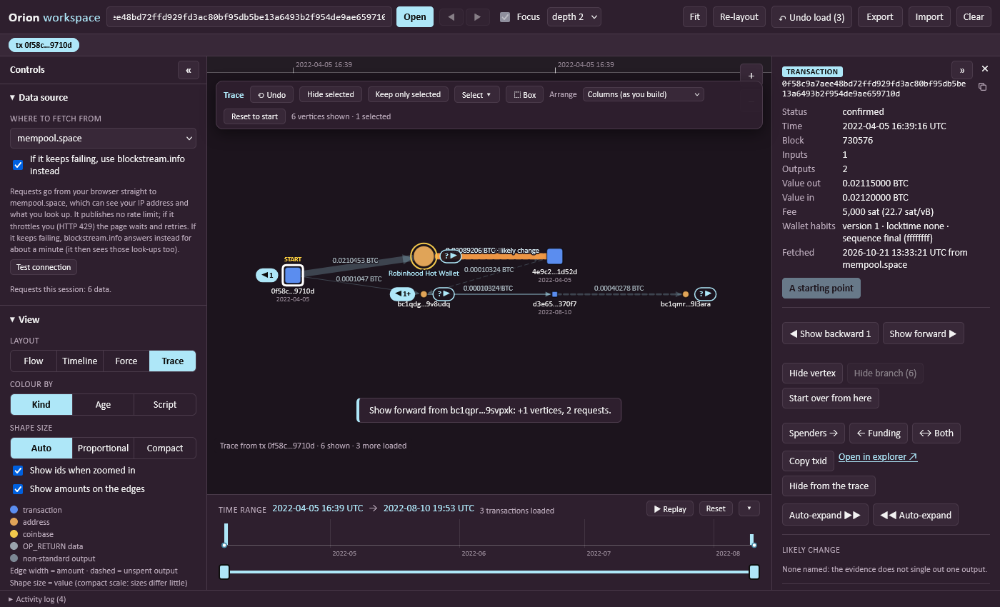

# Hopline

Bitcoin investigation tools that run in your browser: nothing to install and no server of their own. Paste an address or a transaction ID, follow the money, label what you find and write a report you can hand over. Hopline asks a public block explorer API (mempool.space, with Blockstream.info as its backup, or your own server) and keeps your work on your machine.

**Try it:** <https://forensicworks.github.io/hopline/>. Paste an address or a transaction ID (the page says what it recognised and where it can be opened), or press *Try the Colonial Pipeline ransom wallet*.

## What you get

* **Workspace** - a graph of transactions and wallets. Start from one wallet or transaction in the **Trace** layout and click ▶ or ◀ to follow the money one step at a time; what is already on screen stays where it is. Group, hide and filter, replay it through time, undo.
* **Wallet overview** - one address as a ledger: balance, totals, every transaction with its inputs and outputs, the wallets it dealt with most (the chart and that list follow the currency you choose), the whole group of wallets spent with it (*Follow further* widens it round after round, with a clear stop), and an Export menu (CSV, a workspace file, a verifiable report).
* **Names** - a built-in list of exchanges and services, the OFAC and UK sanctions lists, the Ransomwhere ransomware payment addresses, the mining pools' reward addresses and a chosen part of the GraphSense tag packs (all built in and dated, with their sources in [sources.md](sources.md); the sanctions lists are on unless you switch them off, the others when you switch them on), label lists you import and your own labels, tags and notes; an outside look-up (Arkham, on request, one wallet at a time) is one of several sources behind one contract, kept on the wallet and named in the report. A name is somebody's claim, not proof.
* **Analysis, with reasons** - consolidations, batch payments, CoinJoin-like transactions, peel chains, round amounts (a number somebody chose, a lead and not proof of who), swap and bridge memos (an OP_RETURN that asks THORChain to swap the payment into another chain, with the address it is to be paid out to; the OUT: and REFUND: memos THORChain writes on a payment it makes; a cross-chain service's request ID, with a link to look it up; a Rootstock peg-in with its destination: what the sender wrote, a lead to follow there), the likely change output and addresses spent together. All of it is heuristic: it shows its reasons, and none of it is proof.
* **Routes, hand-offs and open ends** - for a named wallet, whether and how money ran between it and the start of your trace, found by following each coin to the transaction that spent it (never by matching addresses, which would join unrelated money), lit on the canvas and listed step by step (the shortest, with a button that looks for up to four more and lists them shortest first); where the trail meets an exchange or other service (a deposit or a withdrawal), or passes a wallet that a sanctions or ransomware list names, as a table to copy, download as CSV, put in the report and read with `tools/hopline-cli.js`; where it is still open, so you can continue from there; and a search that loads from both ends until two wallets meet or it runs out (from a service wallet's side it follows the deposits or withdrawals nearest in time to the other end first, and leaves out those that cannot fit the times of the route). Wallets spent together with a named one get the name (a list's, or a label you gave) *suggested*, never applied by itself.
* **Investigation report** - one self-contained HTML file with the findings, the transactions, where and when each was fetched, and hashes that `tools/verify_report.py` can check.
* **Amounts in a currency** - seven currencies, at each transaction's own time or at today's price.
* **An assistant** (optional) - the evidence as text for any AI assistant, or a model on this computer (Ollama, LM Studio, llama.cpp), which you can also put your own question to, with every id in its answer checked against the evidence. Hopline asks only a model on this computer: there is no option that sends the evidence to a hosted service. See [docs/interface.md](docs/interface.md).

## Privacy

* Everything runs in your browser. The only network requests go to the data source you choose (and mempool.space for prices), which can see your IP address and what you look up. Selecting a single wallet reads its balance (one request with that address; switch it off under *Expansion limits*). A copy you run yourself loads no fonts, analytics or CDNs.
* Nothing is stored on a server. Your session stays in this browser; on the live site it starts switched off, so tick *Keep this session in this browser* if you want it kept.
* Nothing is counted. The live copies (<https://hopline.pages.dev> and the GitHub Pages copy) have no visit counter or analytics, and neither has a copy you run yourself. An open page asks its own site for one small file, `version.json`, now and then, to tell whether a newer version is out. More in [Publishing a copy](https://github.com/forensicworks/hopline/wiki/Publishing-a-copy).
* On the live site your own Esplora server must use `https` and allow cross-origin requests, and Tor is not offered. A copy you run yourself has both. See [Data sources and limits](https://github.com/forensicworks/hopline/wiki/Data-sources-and-limits).

## Run it yourself

Open `index.html` straight from the folder, or run `python tools/serve.py` and open <http://127.0.0.1:8000/index.html>. Prefer that to `python -m http.server`: the standard server lets the browser keep old copies of scripts, so after an update a page can come up blank until you press Ctrl+F5.

## Documentation

The full documentation is in the [wiki](https://github.com/forensicworks/hopline/wiki):

* [Getting started](https://github.com/forensicworks/hopline/wiki/Getting-started) and the [Wallet overview](https://github.com/forensicworks/hopline/wiki/Wallet-overview)
* The workspace: the [Trace layout](https://github.com/forensicworks/hopline/wiki/Trace-layout), [Views and navigation](https://github.com/forensicworks/hopline/wiki/Views-and-navigation) and [Analysis and findings](https://github.com/forensicworks/hopline/wiki/Analysis-and-findings)
* [Labels, tags and packs](https://github.com/forensicworks/hopline/wiki/Labels-tags-and-packs), [Reports and exports](https://github.com/forensicworks/hopline/wiki/Reports-and-exports) and [Fiat values](https://github.com/forensicworks/hopline/wiki/Fiat-values)
* [Data sources and limits](https://github.com/forensicworks/hopline/wiki/Data-sources-and-limits), [Development](https://github.com/forensicworks/hopline/wiki/Development) and [Publishing a copy](https://github.com/forensicworks/hopline/wiki/Publishing-a-copy)

In the repository: [docs/interface.md](docs/interface.md) (the command-line tool and the assistant) and [ROADMAP.md](ROADMAP.md) (what is planned).

## Status and contributing

Hopline is in active development, and the live site runs the latest `master`. Contributions are welcome: see [CONTRIBUTING.md](CONTRIBUTING.md). To report a security problem, see [SECURITY.md](SECURITY.md).

## Credits and licence

Hopline began as a fork of Orion by Kyle Honeycutt ("coinables", 2023 to 2024), a small transaction viewer released into the public domain under the Unlicense. Its viewer pages and the sigma.js library they used have since been removed; what remains of it is the starting list of exchange and service wallets in `public/data/known-addresses.js`, the idea behind the wallet overview, and the early history in this repository. The QR code library in `public/lib` is qrcode.js by davidshimjs (MIT).

Hopline is licensed under the [Apache License, Version 2.0](LICENSE); the notices that go with it are in [NOTICE](NOTICE). Where the lists of names and the other data come from, under what licence, and what was left out is in [sources.md](sources.md). The licence does not give rights to the name Hopline or the logo (Apache-2.0, section 6).
